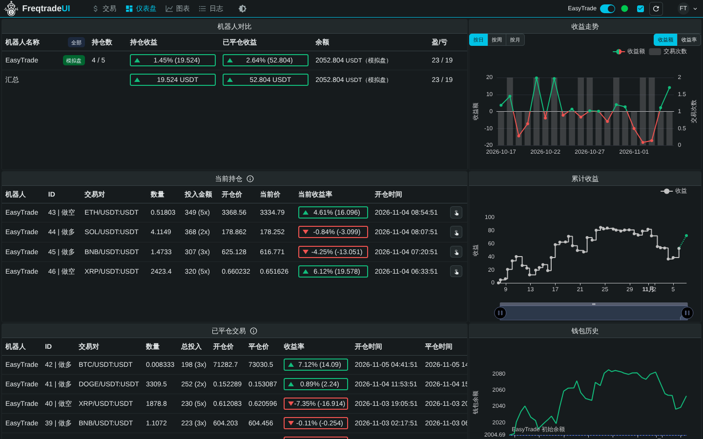

# binance-quant

基于 [freqtrade](https://www.freqtrade.io)（固定版本 **2026.10**）的币安 USDT 本位永续合约量化项目。

目标分三步走：**第一阶段 回测研究 → 第二阶段 模拟盘 + 中文 Telegram 提醒 → 第三阶段 全自动实盘**。
现在处于第一阶段：因为研究服务器在美国（美国 IP 访问币安会被拒），回测先用 **OKX 的 USDT 永续合约数据**。

> 策略说明见 [`docs/strategies.md`](docs/strategies.md)（第 1 步的移植策略）、[`docs/strategies-step2.md`](docs/strategies-step2.md)（第 2 步的新策略：趋势类 + 非趋势类）
> 和 [`docs/strategies-round3.md`](docs/strategies-round3.md)（第 3 轮：截面动量 `XSMomentum`、`BigTrendShortLowRisk`、子账户组合），策略代码在 `user_data/strategies/`。

---

## 风控硬规则

| 规则 | 说明 | 在哪里保证 |
|---|---|---|
| 最大杠杆 **5 倍** | 任何一笔都不能超过 5x | 策略的 `leverage()` 回调统一封顶 5x；`check_drawdown.py` 会检查回测里每笔交易的杠杆 |
| 整体最大回撤 **≤ 15%** | 指**整个账户的权益曲线**（已平仓余额 + 持仓浮动盈亏）从最高点到最低点的跌幅，**不是单笔亏损**。2026-11-07 起是 15%（以前 8%，第 1、2 轮都按 8% 判） | `scripts/check_drawdown.py` 对每个回测结果判定 通过 / 未通过；研究报告、子账户组合检查用同一个上限 |
| 每笔开多少、止损放哪 | 由各个策略自己决定（仓位管理、止损、保护机制） | 策略代码 |
| 资金 | 现在 1000 USDT，以后可能 10000 USDT | 配置里 `dry_run_wallet`；仓位按可用资金比例分配，会随资金自动放大 |

freqtrade 的配置文件里没有"最大杠杆"这个开关，杠杆只能在策略的 `leverage()` 回调里限制，所以这条规则写在策略里，再由回测检查兜底。

**回撤上限只在一个地方定义**：`scripts/check_drawdown.py` 的 `DEFAULT_MAX_DD_PCT = 15`（shell 脚本用 `scripts/_common.sh` 里同样的值，
`scripts/check_portfolio_math.py` 会核对两边一致）。想临时用更严的上限（例如留余量的 12%），不用改代码：

```bash
make backtest MAX_DD_PCT=12          # 也适用于 make check / make research；或者各脚本的 --max-dd 12（命令行优先）
```

研究结果目录的 `plan.json` 会记下当时用的上限，以后重新生成报告仍按它判（第 2 轮的目录里记的是 8）。
要按别的上限重新判一次已经跑完的研究（不重跑回测）：`research_report.py report --run-dir <目录> --max-dd 15`（见「第 2 步：策略研究」）。

跟着回撤上限一起放大的还有共用风控 `easytrade_risk.py` 的默认风险预算（2026-11-07，都放大到 2 倍）：每笔打到止损约亏 **1%**（以前 0.5%）、
所有持仓合计 **6%**（以前 3%）、账户回撤 **8%**（以前 4%）起新仓减半。`BigTrendShort` 等移植策略自己的仓位（每笔 1%）没有改；
`BigTrendShortLowRisk` 是它的一半（0.5%）。

---

## 目录结构

```
binance-quant/
├── README.md                      ← 本文件
├── Makefile                       ← 常用命令快捷方式（make help 查看）
├── requirements.txt               ← freqtrade[hyperopt]==2026.10（含自动调参依赖）
├── .env.example                   ← 密钥模板，复制成 .env 再填（.env 不会提交到 git）
├── configs/
│   ├── config.base.json           ← 共享基础设置（合约、逐仓、USDT、下单方式…）不单独使用
│   ├── config.okx-backtest.json   ← 【入口】第一阶段：OKX 回测
│   ├── config.binance-futures.json← 【入口】第二/三阶段：币安合约 模拟盘 / 实盘
│   ├── config.binance-xsmomentum.json ← 【入口】第 3 轮：截面动量 XSMomentum 单独一个机器人（60 个币、6 个名额）
│   ├── config.okx-pairlist-volume.json ← 【入口】只用来按成交量生成交易对列表
│   ├── config.notify-zh.json      ← 中文 Telegram 通知模板
│   ├── config.synthetic-test.json ← 【入口】合成数据流程自检专用（结果没有意义）
│   ├── config.okx-research.json   ← 【入口】第 2 步策略研究（make research 用）
│   ├── research-overrides/        ← 研究时个别策略自己的设置（例如 XSMomentum.json：max_open_trades 6）
│   ├── pairs.okx-usdt-perp.json   ← OKX 回测用的交易对列表
│   ├── pairs.okx-research.json    ← 第 2 步研究用的约 60 个交易对
│   ├── pairs.binance-usdt-perp.json ← 币安用的交易对列表（20 个，与 pairs.okx-usdt-perp.json 同一批币）
│   └── pairs.binance-research.json  ← 币安上跑 XSMomentum 用的约 60 个币（与 pairs.okx-research.json 同一批，截面排名必须用它）
├── scripts/
│   ├── download_okx_data.sh       ← 下载历史数据
│   ├── backtest_all.sh            ← 批量回测（策略 × 周期）+ 自动回撤检查
│   ├── check_drawdown.py          ← 账户回撤（上限默认 15%）/ 5x 杠杆检查，输出中文表格；回撤上限在这里定义
│   ├── research.sh                ← 第 2 步策略研究（训练段/样本外/走步验证 + 调参，make research）
│   ├── research_report.py         ← research.sh 的辅助脚本（数据检查、区间切分、中文排名表）
│   ├── research_portfolio.py      ← 子账户组合检查（每个策略一个子账户，看合起来的账户权益）
│   ├── fetch_benchmarks.sh        ← 下载固定版本的第三方基准策略并核对 sha256（只在 VPS 上用）
│   ├── research_benchmarks.sh     ← 基准策略研究（make research-benchmarks）
│   ├── check_portfolio_math.py    ← 组合检查的算法自检（手工编的资金曲线 vs 手算答案）
│   ├── check_live_guards.py       ← 实盘保护逻辑自检（make guard-test）
│   ├── check_volume_units.py      ← K线成交量单位自检（OKX 永续 volume = 币的数量）
│   ├── synthetic_test.sh          ← 用合成数据离线自检整条流程（不联网）
│   ├── make_synthetic_data.py     ← 生成合成测试数据（不是真实行情）
│   ├── ft_offline.py              ← 不联网运行 freqtrade 回测/分析（只配合合成数据）
│   ├── update_okx_pairs.sh        ← 按 OKX 成交额重新生成交易对列表
│   ├── test_notify.py             ← 检查/预览/测试发送中文通知
│   ├── run_bot.sh                 ← 不用 Docker 时启动机器人 / FreqUI
│   ├── preflight.sh               ← 启动前安全检查（自动调用）
│   └── _common.sh                 ← 脚本公用函数
├── docker/
│   ├── docker-compose.yml         ← VPS 和 Mac 通用
│   ├── Dockerfile.freqtrade-zh    ← 官方 freqtrade 镜像 + FreqUI 中文版（ui / freqtrade 服务用）
│   └── README.md                  ← Docker 补充说明（Mac / VPS）
├── frequi-zh/                     ← FreqUI 中文版（汉化补丁 + 构建 / 安装脚本，见 frequi-zh/README.md）
│   ├── patches/                   ← 汉化补丁（打在官方 FreqUI 3.2.1 上）
│   ├── build.sh                   ← 克隆官方 FreqUI → 打补丁 → 构建到 frequi-zh/dist（不提交）
│   ├── install-into-venv.sh       ← 把中文版装进 venv 里的 freqtrade（和 install-ui 效果相同）
│   └── screenshots/               ← 中文界面截图
├── docs/
│   ├── strategies.md              ← 第 1 步策略说明
│   ├── strategies-step2.md        ← 第 2 步新策略说明（趋势类 + 非趋势类 + 共用风控）
│   ├── strategies-round3.md       ← 第 3 轮：截面动量 XSMomentum、BigTrendShortLowRisk、子账户组合
│   ├── benchmarks.md              ← 基准策略（freqtrade-strategies、NFI）：来源、固定版本、怎么比
│   └── okx-volume-units.md        ← OKX K线成交量单位说明
└── user_data/
    ├── strategies/                ← 策略代码（benchmarks/ = 基准策略的封顶杠杆子类；vendor/ = 下载的第三方基准策略，不提交）
    ├── data/                      ← 下载的行情数据（不提交）；okx-synthetic/ 是合成测试数据
    ├── backtest_results/          ← 回测结果（不提交）
    └── logs/                      ← 日志（不提交）
```

配置是"拼起来"的：入口配置用 freqtrade 的 `add_config_files` 引入基础配置和交易对列表，**入口文件里写的值优先**。
`.env` 里以 `FREQTRADE__` 开头的环境变量再覆盖配置文件（用来放密钥）。随时可以看最终合并结果：

```bash
make validate                                                    # 校验全部入口配置
.venv/bin/freqtrade show-config --config configs/config.okx-backtest.json   # 查看合并后的完整配置
```

---

## 快速开始

### A. 在 Mac（Apple Silicon，M4 Max）上 —— 推荐 Docker

1. 安装 [Docker Desktop for Mac（Apple 芯片版）](https://docs.docker.com/desktop/setup/install/mac-install/)，打开它。
   建议在 Docker Desktop → Settings → Resources 里给 **至少 8 GB 内存**（1m 数据回测比较吃内存）。
2. 在终端里：

```bash
cd binance-quant
cp .env.example .env            # 回测阶段可以先不填
make pull                       # 拉取 freqtradeorg/freqtrade:2026.10（官方镜像自带 arm64 版本）
make validate FT_RUNNER=docker  # 校验配置
make docker-build               # 构建带中文 FreqUI 的镜像（make ui / make up 用；node:22 和 freqtrade 镜像都有 arm64 版）
```

3. 下载数据、回测（见下面「下载数据」「回测」两节），命令里加 `FT_RUNNER=docker`，或者不加也行（Mac 上没有 .venv 时会自动用 Docker）。

> 不想用 Docker？Mac 自带的 python3 版本太低（freqtrade 需要 Python ≥ 3.12）。可以 `brew install python@3.12`，然后
> `python3.12 -m venv .venv && .venv/bin/pip install -r requirements.txt`；中文界面再 `brew install node@22` 后
> `make zh-build && make zh-install`。

更多 Mac 细节见 [`docker/README.md`](docker/README.md)。

### B. 在美国 VPS（Linux）上 —— Docker 或 venv 二选一

**方式 1：venv（简单直接，推荐）**，需要 Python ≥ 3.12（Ubuntu 24.04 自带 3.12）：

```bash
sudo apt update && sudo apt install -y python3-venv git make
cd binance-quant
make venv                       # 创建 .venv，安装 freqtrade==2026.10 和 FreqUI 网页（英文版）
make zh-build && make zh-install   # 换成 FreqUI 中文版（需要 Node.js >= 22，见「FreqUI 中文界面」）
cp .env.example .env
make validate
```

**方式 2：Docker**：

```bash
curl -fsSL https://get.docker.com | sudo sh     # 安装 Docker（官方脚本）
sudo usermod -aG docker $USER                    # 重新登录后生效
cd binance-quant
cp .env.example .env
sudo chown -R 1000:1000 user_data                # 容器里的用户 uid 是 1000，需要写权限
make pull && make validate FT_RUNNER=docker
make docker-build                                # 构建带中文 FreqUI 的镜像（ui / freqtrade 服务用）
```

---

## 下载 OKX 历史数据

```bash
make download ARGS="--timeframes '1h 4h 1d'"               # 研究只要这三个周期（make research 会自己下载，不用先跑这个）
make download                                              # 默认：2021-01-01 至今，1m 5m 15m 1h 4h 1d 全部周期（1m 要好几个小时）
make download ARGS="--timerange 20230101-"                 # 指定开始日期
make download ARGS="--timeframes '5m 15m 1h 4h 1d'"        # 跳过 1m（快很多）
make download ARGS="--pairs 'BTC/USDT:USDT ETH/USDT:USDT'" # 只下几个币
# 等价于：bash scripts/download_okx_data.sh --timerange 20230101- ...
```

- 合约模式会同时下载 `mark`（标记价格）和 `funding_rate`（资金费率），用于计算资金费。
  OKX 的资金费率只有最近约 3 个月，所以对 OKX 这两样只下最近 120 天（`--funding-days` 可改，0 = 从开始日期下，要多花 2~3 小时）。
- 已下载的数据再次运行只会**增量补齐**到今天。本地数据比开始日期晚开始的币（例如以前只下了 2024 年起的），
  脚本会自动用 `--prepend` 补前面那段（`--no-backfill` 关掉；本来就上线晚的币不补）。
- 下载前脚本会估算这次要发多少次请求、大约多久。
- **1m 很慢**：OKX 历史 K 线每次请求最多 300 根，1m 一个币一年约 1750 次请求（约 3 分钟），20 个币从 2021 年起要好几个小时，
  建议放在 VPS 上用 `tmux` / `screen` 后台跑，或者先 `--timeframes '5m 15m 1h 4h 1d'` 跳过 1m。
- 查看已有数据：`.venv/bin/freqtrade list-data --config configs/config.okx-backtest.json --trading-mode futures --show-timerange`
- 交易对列表在 `configs/pairs.okx-usdt-perp.json`（20 个两边都有的主流币）。想按 OKX 当前成交额重选：`make pairs`。

---

## 回测

```bash
make backtest                                                    # 回测全部策略（各用自己的周期）
make backtest ARGS="--strategies 'StratA StratB'"                # 只测指定策略
make backtest ARGS="--timerange 20240101-20250101"               # 指定区间
make backtest ARGS="--timeframes '15m 1h 4h'"                    # 覆盖策略周期，每个周期测一遍（仅适用于支持多周期的策略）
make backtest ARGS="--detail 5m"                                 # 用更小周期模拟 K 线内部走势，止损判断更准（需要已下载该周期数据）
# 等价于：bash scripts/backtest_all.sh ...
```

每次批量回测的结果放在 `user_data/backtest_results/run_<时间>/`：

| 文件 | 内容 |
|---|---|
| `backtest-result-*.zip` | freqtrade 原始结果（含当时的策略代码和配置，可复现）。回撤检查读这里的文件 |
| `logs/<策略>__<周期>.log` | 每次回测的完整输出（含月度收益表） |
| `summary.txt` / `summary.csv` | 回撤检查汇总（csv 可用 Excel 打开） |

FreqUI 的回测历史列表只认 `user_data/backtest_results/` 这一层的文件（不看子目录），所以脚本会把每个
`backtest-result-*.zip`（和同名 `.meta.json`）再复制一份到 `user_data/backtest_results/`，FreqUI 里才能看到。
合成数据（`synthetic/` 目录）的结果不复制。

回测默认开启 `--enable-protections`（策略里写的保护机制在回测中也生效）和 `--cache none`（每次重新计算）。

**建议的研究纪律**：把数据分成"训练段"和"验证段"（例如 2024 全年调参，2025 年只验证不改参数），只有两段都通过才算数。

---

## 看懂回撤检查（上限 15%）

```bash
make check                                                       # 检查最近一次回测
make check ARGS="user_data/backtest_results/run_20251101_120000" # 检查一个批次
make check MAX_DD_PCT=12                                         # 用更严的 12% 上限检查（留余量）
.venv/bin/python scripts/check_drawdown.py <目录或zip> --max-dd 15 --max-leverage 5 --min-trades 30
```

请用 `make check` 或 `.venv/bin/python`（Docker 用户 `make check` 会自动用容器里的 python）运行：
这样才有 pandas，能读回测用的K线逐根计算"含浮亏"回撤。用 Mac 自带的 `python3` 也能跑，但"含浮亏"那一列只是估算（标"估"）。

输出示例：

```
账户整体最大回撤上限（含浮亏）：15% = 项目硬规则（2026-11-07 起 15%；第 1、2 轮是按 8% 判的）    杠杆上限：5x
+--------+---------+------+-----------------------+--------+--------+--------+----------+--------+--------+------------+-----------------+----------+
| 结论   | 策略    | 周期 | 回测区间              | 交易数 | 胜率   | 总收益 | 盈亏因子 | Sharpe | Calmar | 回撤(平仓) | 回撤(含浮亏)    | 最大杠杆 |
+--------+---------+------+-----------------------+--------+--------+--------+----------+--------+--------+------------+-----------------+----------+
| 通过   | TrendA  | 1h   | 2024-01-01~2025-01-01 |    120 | 55.00% | 35.00% |     1.40 |   1.20 |   3.40 |      9.00% |  11.50% K线(1h) |       3x |
| 未通过 | MeanRev | 15m  | 2024-01-01~2025-01-01 |     12 | 41.67% | -2.00% |     0.90 |  -0.30 |  -0.20 |     12.00% | 16.40% K线(15m) |       5x |
+--------+---------+------+-----------------------+--------+--------+--------+----------+--------+--------+------------+-----------------+----------+

说明：
- MeanRev（15m）
    未通过：最大回撤 16.40% 超过上限 15%
    提醒：交易数只有 12 笔（< 30），统计上不可靠
    提醒：回测期内总收益 <= 0，回撤达标也没有意义
```

| 列 | 含义 |
|---|---|
| 回撤(平仓) | 只按**已平仓**交易累计的账户余额曲线算的最大回撤（取 freqtrade 的 `max_drawdown_account` 与 `max_relative_drawdown` 较大者） |
| 回撤(含浮亏) | 按**账户权益 = 已平仓余额 + 所有持仓的浮动盈亏**算的最大回撤，更接近你在交易所账户里看到的数字。标 `K线(1h)` 表示逐根 K 线计算：每根 K 线按对持仓最不利的价格（多单最低价、空单最高价）算浮亏，日线/4h 策略用 1h K 线算得更细；标 `估` 表示没有 pandas 或找不到 K 线数据时的估算（用每笔交易到过的最差价格，假设同时到达，一般偏大） |
| 结论 | 两种回撤**都 ≤ 上限**（默认 15%，`MAX_DD_PCT` / `--max-dd` 可改）、杠杆 **≤ 5x**、且有交易，才算"通过"。表头写着这次用的上限，以及它和项目硬规则的关系（比硬规则宽时会打 `!!` 提醒） |
| 盈亏因子 | 总盈利 ÷ 总亏损，> 1 才赚钱，一般希望 > 1.3 |
| Sharpe / Calmar | 风险调整后收益；Calmar = 年化收益 ÷ 最大回撤，越大越好 |

表格下方还会列出"提醒"：交易数太少（< 30 笔统计上不可靠）、回测期总收益 ≤ 0 等。

> 注意：freqtrade 自己报告里的 `Max % of account underwater (balance)`（"wallet based"）在**合约模式下只统计已平仓余额，不含浮亏**
> （已对照 freqtrade 2026.10 源码 `wallets.py` 确认），所以不能拿它当"含浮亏回撤"。以本脚本的"回撤(含浮亏)"为准。
> K 线数据目录默认是 `user_data/data/<交易所>`（例如 `user_data/data/okx`），不在默认位置时加 `--datadir <目录>`。
退出码：0 = 全部通过，1 = 有未通过，3 = 没找到结果（方便以后写自动化）。

> 回测回撤 ≤ 15% **不等于**实盘一定 ≤ 15%（滑点、极端行情、数据差异）。建议回测目标留余量，例如 ≤ 12%（`MAX_DD_PCT=12`）。

---

## 第 2 步：策略研究

第 1 步的教训：6 月那几个"只做空"策略在 90 天里很好看，换到 2024-01 ~ 2026-11 的完整行情就不行了 —— 那是熊市带来的，不是策略本身的本事。
第 2 步要找的是**在"没参与调参的那段行情"（样本外）上也赚钱**、账户回撤 ≤ 15%（2026-11-07 起；以前 8%）的策略。`make research` 一条命令把整套检查跑完。

**第 2 轮的真实结果**（2026-11-06，VPS，57 个币，2024-01 ~ 2026-11，手续费+滑点 0.07%/边；当时按 8% 回撤上限判，共用风控每笔风险 0.5%）：**0 个通过**
（按现在的 15% 重新看也是 0 个：排在前面的几个样本外盈亏因子都 < 1.2）。
日线趋势策略样本外接近不赚不亏（BigTrendShort +2.27%、PF 1.15，但训练段回撤 11.1%、超过当时的 8%；BigTrendBoth 样本外 +1.08% 但训练段亏损；TsmomTrend +0.78%）；
**调参严重过拟合**（DonchianTrend 调参后训练段 PF 4.31 → 样本外 0.79，走步各折调出的参数跳来跳去）；
1h 策略一年约 1200 笔，被手续费吃光。另外，2024-01-01 只是我们自己定的默认开始日期，样本外只有一年，等于只看了一种行情。

所以**第 3 轮**（现在的默认设置）改成：

- **数据从 2021-01-01 开始**（约 5.8 年，包含 2021 年牛市和 2022 年熊市），样本外约 2 年；
- **默认不调参**，只看策略代码里的默认参数（想调参：`make research RESEARCH_HYPEROPT=1`，结果要打问号）；
- 默认只研究日线策略：`BigTrendShort`、`BigTrendShortLowRisk`、`BigTrendBoth`、`TsmomTrend`、`DonchianTrend`、`XSMomentum`（截面动量）。
  1h 策略（`RangeMeanReversion`、`VolSqueezeBreakout`、`FundingContrarian`）还在，要看就用 `--strategies` 指定。
- 新增**子账户组合检查**（见下面「组合检查（多个子账户合起来看）」）：每个策略一个子账户，判定看所有子账户加起来的账户权益。
- `XSMomentum` 默认多空各 3 笔，要 6 个仓位名额，研究时自动叠加 `configs/research-overrides/XSMomentum.json`（`max_open_trades` 6，只对它生效；
  它实盘时也是单独一个机器人：`configs/config.binance-xsmomentum.json`，交易对必须是研究排名的那一批约 60 个币，不能用 20 个币的币安列表）。
  别的策略想要自己的研究设置，照样建 `configs/research-overrides/<策略类名>.json`。
- **样本外这段第 2 轮已经看过**：第 3 轮的样本外（约 2024-11 ~ 2026-11）整段都在第 2 轮用过的数据里（2024-01-01 以后），
  第 3 轮的策略选择（只留日线策略）、`BigTrendShortLowRisk` 的仓位都是看着它定的，所以样本外**不是独立证据**。
  真正没看过的只有 **2021-01-01 ~ 2023-12-31**（训练段的前一部分）：研究脚本把这段单独用默认参数回测一次（"没看过的一段"），
  排名表后面单独一张表（含每年赚亏），单个策略和组合都要这一段也赚钱、回撤 ≤ 上限（默认 15%）才算通过（`RESEARCH_SEEN_FROM`，默认 20240101）。
- **回撤上限 15%**（2026-11-07 起，以前 8%），共用风控的默认仓位跟着放大到 2 倍（每笔 1%，见「风控硬规则」）。
  所以用共用风控的策略（`BigTrendShort`、`BigTrendShortLowRisk` 不用它，仓位没变）在同样的行情下，收益和回撤大约是第 2 轮的两倍，
  和第 2 轮的数字直接比时要记住这一点；盈亏因子不受仓位大小影响。

每个策略的思路、参数、风险见 [`docs/strategies-step2.md`](docs/strategies-step2.md)。杠杆代码里写死不超过 5 倍。

**和别人公开的策略比（基准策略）**：freqtrade-strategies 的 `futures/` 策略和 NostalgiaForInfinity X8（固定版本、GPL-3.0、不进 git），
用同一套流程、同样的 15% 规则、只用默认参数跑一遍作对照。在 VPS 上：`bash scripts/fetch_benchmarks.sh`（下载并核对 sha256）→
`make research-benchmarks`（要大半天）。是什么、要多久、怎么比、NFI 为什么不适合直接实盘：[`docs/benchmarks.md`](docs/benchmarks.md)。

### 在 VPS 上运行

```bash
cd binance-quant                   # 进入项目目录（按你实际放的位置）
tmux new -s research              # 用 tmux：SSH 断开也不会停。重新连上后：tmux attach -t research
make research                     # 下载/更新数据（第一次会自动补 2021 年以来的数据）→ 默认参数回测 → 中文排名表
```

常用写法：

```bash
make research ARGS="--strategies 'BigTrendShort TsmomTrend'"   # 只研究几个策略
make research ARGS="--no-download"                         # 数据已经是最新的，不再下载
make research ARGS="--start 20240101"                      # 换回第 2 轮的区间（对比用）
make research RESEARCH_HYPEROPT=1                          # 另外再自动调参（慢很多；第 2 轮证明很容易过拟合）
make research RESEARCH_MIN_TRAIN_DAYS=180                  # 放宽"上线晚的币"的要求（默认：样本外开始前要有 365 天能交易的历史）
make research RESEARCH_WF_FOLDS=4 RESEARCH_WF_TEST_DAYS=270    # 改走步验证的折数 / 每折测试天数（训练窗口：RESEARCH_WF_TRAIN_DAYS）
make research MAX_DD_PCT=12                                # 用更严的回撤上限判定（默认 15 = 项目硬规则；也可以 ARGS="--max-dd 12"）
make research-synthetic                                    # 合成数据离线跑一遍流程（6 个策略 × 9 段 = 54 次回测，约 15 ~ 20 分钟；数字没有意义）
bash scripts/research.sh --help                            # 全部参数
```

调参要用到 hyperopt 依赖（Docker 镜像已自带；以前建的 .venv 补装一次：`.venv/bin/pip install -r requirements.txt`），没装时脚本会提示并只跑默认参数。

**下载要多久**（按 freqtrade 2026.10 + ccxt 4.5 的源码算的；开发机连不上 OKX，没法实测）：

- OKX 的历史K线接口（`history-candles`）每次请求最多给 **300 根**，ccxt 按约 0.11 秒一次限速（每秒约 9 次）。
  一个币 1h/4h/1d 从 2021 年起约 220 次请求 ≈ 25 秒，**60 个币第一次下载约 35 ~ 45 分钟**（研究还会多下约 600 天给指标预热，见下面）。
- 你 VPS 上已经有 2024-01-01 以来的数据：脚本会**自动只补前面那段**（见下面"它做了什么"第 1 条），约 **20 分钟**；以后每次只补最新几天，一两分钟。
- 标记价格、资金费率每次只给 100 条（资金费率还要 0.22 秒一次），从 2021 年起全部下载要多花 2~3 小时。
  可 OKX 的资金费率只有最近约 3 个月，更早的回测本来就按资金费 0 算，那段标记价格也用不上，所以脚本对 OKX **只下最近 120 天的**（`--funding-days` 可改）。
- 下载前脚本会按本地已有的数据估算"这次要发多少次请求、至少多少分钟"，打印在屏幕上。
- 对照：第 2 轮 VPS 上下载这一步用了约 1 小时（60 个币从 2024-01-01 起；那时标记价格/资金费率是全区间下载，大部分时间花在它们上面）。

**回测要多久**（4 核 VPS 粗估）：6 个策略 ×（训练段 + 没看过的一段 + 样本外 + 走步 6 折）= 54 次回测，数据比第 2 轮长一倍左右，
共约 **1 ~ 2 小时**（第 2 轮 42 次默认参数回测用了 26 分钟）。打开调参还要再加几个小时；
调参时每个进程要装一份全部K线（约 6 年数据，**约 2 GB / 个**），脚本按 CPU 核数和可用内存自动决定开几个进程（`RESEARCH_JOBS=1` 可以强制只开 1 个；
内存不够、子进程被系统杀掉时会自动改成 1 个进程重跑那一次）。每次调参跑 60 轮、另有 60 分钟保险时限，细节见 `bash scripts/research.sh --help`。

中途按 **Ctrl+C** 会停下来，并用已经跑完的部分生成报告（调参时，调参开始前还会先打印一张"默认参数阶段"的表）。

### 它做了什么

1. **数据**：用 `scripts/download_okx_data.sh` 下载 `configs/pairs.okx-research.json` 里约 60 个币的 1h / 4h / 1d K线（合约模式带资金费率和标记价格）。
   - 下载从"研究开始日期再往前约 600 天"开始（日线指标预热要用；交易所没有那么早的数据就从有的那天开始，不报错），
     这样训练段第一天指标就是"热"的。多下的那段只用来预热，不交易。
   - **自动补早期数据**：freqtrade 默认只往后补新数据。本地数据如果是从 2024-01-01 开始的，就算开始日期改成 2021，它也不会自己去下更早的。
     所以脚本先看每个币本地的第一根K线：比开始日期晚、又不是因为"这个币本来就上线晚"（按 OKX 接口里的上线时间判断）的，
     就用 `--prepend` 只补前面那段（`--no-backfill` 可以关掉）。
   - **上线晚的币不再整个去掉**（第 2 轮会去掉所有"比开始日期晚 30 天以上才有数据"的币，从 2021 年算的话一大半都没了）：
     现在只要**样本外开始之前至少有 365 天"能交易"的历史**（`RESEARCH_MIN_TRAIN_DAYS`）就保留。
     "能交易"不是"有K线"：freqtrade 回测时按"根数"把每个币自己开头的预热K线裁掉，一个币要到 **第一根K线 + 这一段的指标预热** 之后才开始交易。
     训练段只给策略自己的预热（日线 130 ~ 300 天）；样本外、走步各段给得更多（最多 600 根，见第 2 条），上线晚的币在那几段里要等约 600 天。
     所以保留的条件是：第一根K线 + 训练段预热（最多 300 天）之后，到样本外开始还有 365 天以上。不够的去掉，免得一个币在训练段里一笔都没做、
     到样本外才加入，训练段和样本外比较的不是同一批币。中途断了（已下架/没更新）的币、历史太短的币照样去掉。实盘只要等策略自己的预热。
   - 实际用到的币写在结果目录的 `pairs.effective.json`。`data_check.txt` 里列出**每个币在训练段里从哪天开始能交易**（按年份分组）、
     "每个时间点 能交易/有数据 的币"和"每一段第一天就能交易的币有几个"：越早的年份参与交易的币越少，看训练段结果时要记得这一点。
   - OKX 上 USDT 永续最早能下到哪天，开发机连不上没法确认，`data_check.txt` 里每个币的第一根K线日期就是答案。
     如果大部分币 2021 年才有数据，日线策略（预热 200 ~ 300 天）实际要到 2021 年下半年才开始交易，2021 年上半年的牛市就只用来预热了
     （`data_check.txt` 里"2021-01-01 能交易的币 N 个"就是答案）。
   - **幸存者偏差**：交易对是今天挑的"现在还在交易的大币"，这几年里下架或归零的币（例如 2022 年崩盘的 LUNA、FTT）根本不在列表里。
     历史越长，这个偏差越大，结果偏乐观。
2. **切分区间**（所有策略用同一套日期）：
   - **训练段** = 前约 2/3（2021-01 ~ 2024-11 前后），**样本外** = 最后约 1/3（约 2 年）。调参时只用训练段，调参没用过样本外这段；
     但第 3 轮的样本外第 2 轮已经看过（见上面），**以"没看过的一段"为准**。
   - **没看过的一段** = 训练段里 `RESEARCH_SEEN_FROM`（默认 2024-01-01）之前的部分，即 2021-01-01 ~ 2023-12-31：以前的研究没用过这段数据，
     每个策略用默认参数单独回测一次（调参的结果不算：调参用的训练段包含这一段）。
   - **走步验证**：从数据末尾往前排 **6 折**，每折先用它前面的 **365 天**训练（调参时）、再测后面 **180 天**没见过的行情
     （不调参时就直接用默认参数测这 6 段），最后把 6 段测试结果按时间顺序拼成一条资金曲线。6 × 180 天 ≈ 最近 3 年；
     数据放不下 6 折时自动减少折数（`data_check.txt` 里会写）。它回答"策略是不是每段行情都赚钱，还是只靠某一段大行情"。
     注意：不调参时，走步各折和训练段/样本外是**同一段行情**切成小段，不是额外的独立证据；调参时，走步的后几折会用样本外这段时间重新调参，
     所以"优化参数"那一行的样本外和走步结果**不是两份独立证据**（同一段行情用了两次）；"默认参数"那一行不受调参影响。
   - 日线策略要先用 200 ~ 300 根日线"预热"指标（EMA200 等），预热期不交易。
   - 样本外、走步各折这些从中间开始的段，开始前脚本给**最多多加载 600 根K线**预热指标
     （有多少给多少，研究开始日期之前多下的那段也算；`RESEARCH_WARMUP_CANDLES` 可改）。EMA200 这类指标只给 300 根时还带着约 37% 的"起点误差"，
     各段的信号会随切分点变化；600 根时只剩约 2%，和"从头连续回测"、OKX 实盘（freqtrade 内存里保留约 600 根）基本一致。
     训练段和"没看过的一段"从数据开头开始，只给策略自己的预热长度：给 600 根的话，2020 年才上线的币会在训练段里闲置到第一根K线之后 600 天，
     2021 年的牛市就只剩一两个币能交易了（第 3 轮复查发现、已经改掉）。
3. **默认参数**回测：每个策略的 训练段、没看过的一段、样本外、走步各折。
4. **调参**（hyperopt，只有 `RESEARCH_HYPEROPT=1` 时才做）：只调入场/离场参数，只用训练窗口；
   **默认参数在训练段都不赚钱、或者交易不到 20 笔的策略不调参**（不靠调参去"救"一个本来就没优势的策略；
   交易太少时调参每一轮都会被判"交易数不够"）。走步每一折的训练窗口也先用默认参数回测一次，交易不到 20 笔的那一折不调参、用默认参数。
   调出来的参数只保存在结果目录（`params/`），拿去测样本外；**不会改 `user_data/strategies/` 里的任何文件**。
5. **评估**：和 `make check` 同一套算法（账户权益含浮亏、逐根K线），生成中文排名表。

### 怎么看排名表

跑完会打印一张表（同时存为 `summary.txt`，可以直接复制发给别人），每个策略一行"默认参数"，调过参的再多一行"优化参数"：

| 列 | 含义 |
|---|---|
| 训练收益 / 训练PF / 训练回撤 | 训练段的总收益、盈亏因子（总盈利 ÷ 总亏损）、账户最大回撤（含浮亏） |
| 样本外收益 / 样本外PF / 样本外回撤 / 样本外交易 | **最重要的几列**：训练段调出的参数没见过的最后 1/3 行情上的表现 |
| 样本外扣资金费 | 样本外收益再扣掉**估算**的资金费（见下面"资金费"那条）。只用来提醒，不参与"通过"判定 |
| 走步收益 / 走步回撤 | 走步验证拼起来的总收益和回撤。"优化参数"那一行的走步是每折重新调参后的结果 |
| 主要原因 | 没通过的第一条原因；全部原因写在表格下面的"说明"里 |

**"通过"要同时满足**（样本外和走步拼接结果都要）：账户权益回撤（含浮亏）≤ 15%、总收益 > 0、盈亏因子 ≥ 1.2、交易 ≥ 30 笔、杠杆 ≤ 5x；
另外训练段也要赚钱、回撤 ≤ 15%，样本外盈亏因子不低于训练段的 0.6 倍（调参后样本外"断崖式变差" = 过拟合）；
**没看过的一段**（默认参数那一行）也要赚钱、回撤 ≤ 15%。
（15% = 默认上限 = 项目硬规则；用 `MAX_DD_PCT` / `--max-dd` 改了的话按改后的值判，报告表头写着这次用的是多少。）

按别的上限**重新判一次已经跑完的研究**（不重跑回测，几秒钟；会覆盖那个目录里的 summary.txt / portfolio.txt）：

```bash
.venv/bin/python scripts/research_report.py report --run-dir user_data/research/run_<时间> --max-dd 15
```

排名表下面还有一张"**没看过的一段**"的表：每个策略这一段的收益、盈亏因子、回撤、交易数，以及每一年平仓赚亏多少
（2021 牛市、2022 熊市、2023 年分开看，看策略是不是只靠某一年）。第 3 轮的样本外第 2 轮已经看过，这张表才是这一轮唯一的独立证据。

看表的几条经验：

- **两行都通过时用"默认参数"那一行**：自由度越少越不容易是巧合。只有"优化参数"通过、"默认参数"差很远的，要打个问号。
- 说明里的"走步各折参数"（调参时才有）：每折调出来的参数应该差不多；如果每折都跳到完全不同的值，说明是在拟合噪音。
- 说明里的两种提醒（第 3 轮）：`XSMomentum` 的"**最小下单额**"= 排名进了前 K 名、但仓位太小开不出来的次数（那个名额空到下一个调仓日，次数多说明结果是"少开了几笔"的结果）；
  `BigTrendShortLowRisk` 的"**和 BigTrendShort 逐笔对比**"= 原版有几笔这里没开出来、几笔仓位没减半（合约张数取整），核对"仓位减半 → 回撤、收益减半"在这份数据上成不成立。
- 有 2 个以上策略通过时，表格下面有**组合检查（同一个账户叠加）**：把它们放进同一个 1000 USDT 账户一起跑（样本外区间），看合起来回撤是否还 ≤ 上限（默认 15%）。
  它和再下面的"**子账户组合检查**"不是一回事：子账户组合检查不要求单个策略先通过（见下面「组合检查（多个子账户合起来看）」）。
- **资金费**：OKX 只能下载最近约 3 个月的资金费率，在那之前持仓的资金费 freqtrade 按 0 算（样本外约 2 年，大约 9 成的时间是这样），
  拿得久的趋势策略会显得偏好。"样本外扣资金费"列按每 8 小时 0.01%（做多付、做空收）把这部分补算进去；
  如果样本外只是小赚、扣完资金费就不赚了，就当它**还没证明能赚钱**。
- **不要**为了让某一行变成"通过"反复改参数、改区间、重跑 —— 试的次数多了，总能"碰"出一个好看的结果，那也是过拟合。
  通过的策略下一步是模拟盘，不是加仓。

结果目录 `user_data/research/run_<时间>/`（合成数据在 `user_data/research/synthetic/`）：

| 文件 | 内容 |
|---|---|
| `summary.txt` / `summary.csv` / `summary.json` | 排名表（csv 可用 Excel 打开） |
| `data_check.txt` / `pairs.effective.json` | 数据检查结果（含每个币每一段从哪天开始能交易、每段时间有几个币、样本外是不是以前看过）、实际用到的交易对 |
| `params/<策略>__main.json`、`__wf<折>.json` | 调出来的参数（freqtrade 参数文件格式） |
| `bt/<策略>__<参数>__<区间>/` | 每次回测的 freqtrade 原始结果（`make check ARGS="<这个目录>"` 也能单独检查） |
| `hyperopt/*.fthypt`、`logs/`、`research.log` | 调参原始记录、每一步的完整日志 |

> 想把某个调出来的参数正式用上：把 `params/<策略>__main.json` 复制成 `user_data/strategies/<策略>.json`，
> freqtrade 回测和实盘都会自动读取它（删掉这个文件就回到代码里的默认参数）。请先确认它在样本外和走步里都通过了。
>
> 技术说明：freqtrade 2026.10 的 hyperopt 多进程模式遇到"策略 + 风控 mixin"这种写法会报 `PicklingError`，
> 研究脚本里已经自动绕过（见 `scripts/research_report.py` 的 `_patch_pickle_magic`），不用管。

### 组合检查（多个子账户合起来看）

第 3 轮的思路：单个策略都只是"接近不赚不亏"，那么几个**彼此不太相关**的日线策略放在一起，合起来的回撤会不会更小、能不能达标？
freqtrade 不能在同一个账户里同时跑两个带杠杆的机器人，所以实盘做法是**每个策略一个币安子账户、一个机器人**，
总资金按比例分开（思路见 [`docs/strategies-round3.md`](docs/strategies-round3.md) 第 3 节）。排名表下面的"**子账户组合检查**"一节就是按这个做法算的：

- **怎么算**：1000 USDT 按权重分到各子账户，之后子账户之间不挪钱。策略是按账户权益的比例定仓的，所以分到 500 USDT 的子账户，
  资金曲线 = 这个策略自己回测（1000 USDT）的资金曲线 × 0.5。每条曲线都含浮亏、逐根K线（和排名表回撤同一套算法），
  按小时对齐后相加，得到"所有子账户加起来"的权益曲线，**判定看的是这条曲线的回撤**，不是每个子账户各自的回撤。
  训练段、没看过的一段、样本外、走步拼接分别算。
- **放哪几个策略**：默认 = "默认参数"那一行**训练段赚钱、训练段盈亏因子 ≥ 1.0、训练段回撤 ≤ 上限（默认 15%）** 的策略（不要求单个策略先通过 —— 接近不赚不亏的正是要看的）；
  **训练段日收益相关系数 ≥ 0.7 的两个只留一个**（例如 BigTrendShort 和 BigTrendShortLowRisk 是同一个信号，留训练段收益/回撤比更好的那个）；
  不到 2 个就不做。也可以自己指定：`make research RESEARCH_PORTFOLIO="BigTrendShortLowRisk,TsmomTrend,XSMomentum"`。
  **只按训练段挑、不看样本外**：以前是按样本外挑的，再用样本外判"通过"，等于自己给自己打分（第 3 轮复查改的）。
  按训练段挑，组合的训练段（和其中"没看过的一段"）数字会偏乐观；自己指定时如果是看着样本外挑的，样本外一样偏乐观。
- **怎么分钱**：默认平均分；`RESEARCH_PORTFOLIO_WEIGHTS=riskparity` = 按每个策略**训练段**日收益波动率的倒数分（波动大的分少，只用训练段，不看样本外）。
  表里也会顺便写出风险平价的话权重是多少。第一次建议平均分，不要按回测结果精细调比例（那也是过拟合）。
- **"通过"的标准和单个策略一样**：组合的样本外和走步拼接 回撤 ≤ 15%、赚钱、盈亏因子 ≥ 1.2（所有子账户的交易按子账户资金缩放后一起算）、交易 ≥ 30 笔、杠杆 ≤ 5x；
  组合训练段也要赚钱、回撤 ≤ 15%；样本外盈亏因子不低于训练段的 0.6 倍；组合在没看过的一段也要赚钱、回撤 ≤ 15%。
  判的是所有子账户加起来的总权益（含浮亏），不是每个子账户各自的回撤。
- **怎么看**：
  - 组合表：三段各自的总收益、年化、回撤、盈亏因子、交易数、Sharpe（日收益，按 365 天年化）、Calmar（年化 ÷ 回撤）；走步还有每折的组合收益。
  - 子账户表："收益""回撤"是子账户自己的（和排名表里这个策略的数字一样），"贡献" = 这个子账户赚/亏的钱占总资金的百分比，几个贡献加起来 = 组合收益。
  - **相关系数矩阵**（子账户日收益）：接近 1 = 同涨同跌，放在一起分散不了风险（例如 BigTrendShort 和 BigTrendShortLowRisk 本来就是同一个策略），≥ 0.7 会提醒；
    接近 0 或负数才有分散效果。训练段和样本外都列出来，两段差很多说明这个"低相关"靠不住。
  - **最小下单额检查**：钱分到几个子账户以后，每笔仓位会很小（例如 333 USDT 的子账户、每笔风险 1%、止损 15%，名义仓位只有约 21 USDT；
    `BigTrendShortLowRisk` 每笔 0.5%，只有约 10 USDT）。
    币安 U 本位合约每笔名义金额大部分币至少 5 USDT，BTC、ETH 高得多（写这段时约 100 / 20 USDT，以币安当时的规则为准），
    freqtrade 还要在上面多留余量，差一点会把仓位放大（最多 30%），差太多就**不开这一笔**。
    这一节按回测里每笔的实际仓位缩放到子账户资金，数出有几笔会开不出来、是哪些币，并估算"总资金至少要多少"才够。
    有开不出来的交易时，组合结果比实盘乐观；真要上线前，按子账户的实际资金单独回测一次再确认。
- 结果另存在运行目录的 `portfolio.txt`（和 summary.txt 里那一节相同）、`portfolio.csv`（Excel 可打开，每段一行组合 + 每个子账户一行）、
  `portfolio.json`（全部数字，含相关系数矩阵、权重、最小下单额明细）。
- **不重跑回测、换一组策略或换权重再算一次**（几秒钟）：

  ```bash
  .venv/bin/python scripts/research_portfolio.py --run-dir user_data/research/run_<时间> --strategies "BigTrendShortLowRisk,TsmomTrend"
  .venv/bin/python scripts/research_portfolio.py --run-dir user_data/research/run_<时间> --weights riskparity
  ```

  （Docker：`docker compose -f docker/docker-compose.yml run --rm --entrypoint python cli scripts/research_portfolio.py --run-dir ...`）
  同样地，**不要**反复换组合直到某一组"通过" —— 试的组合越多，越容易碰巧挑出一组好看的。
- 算法自检：`.venv/bin/python scripts/check_portfolio_math.py`（手工编的资金曲线，和手算答案对；也核对回撤上限只定义了一处、判定按它来；
  加 `--run-dir <目录>` 再拿一次研究结果核对）。

---

## 用合成数据自检（不联网）

在连不上交易所的机器上（或者改完配置/策略想快速确认"有没有改坏"），可以用**随机生成的合成行情**把整条流程跑一遍：

```bash
make synthetic-test                      # = bash scripts/synthetic_test.sh，约 10 分钟
make synthetic-test ARGS="--quick"       # 跳过第 4 步的未来函数/预热检查（约 4 分钟）
make synthetic-test ARGS="--regen"       # 重新生成合成数据
make guard-test                          # 只跑第 3 步：实盘保护逻辑自检（几秒钟）
```

它会依次做：

1. `scripts/make_synthetic_data.py` 生成 8 个币（BTC ETH SOL XRP DOGE LINK ADA AVAX）、2020-01-01 至今的合成 K 线
   （1h/4h/1d 全部区间，5m/15m 只有最近 730 天），以及最近约 92 天的标记价格和资金费率（模仿 OKX 只有约 3 个月历史），
   放在 `user_data/data/okx-synthetic/`（约 65 MB，不提交 git）。其中 3 个币"上线晚"（SOL 2021-06-01、AVAX 2022-09-15、ADA 2024-06-01，
   那天之前没有数据），用来测试研究脚本对上线晚的币的处理；`make research-synthetic` 也用这份数据（研究从 2021-01-01 开始，
   前面那一年只用来预热，和 VPS 上的真实情况一样）。想要第 2 轮那样的 2 年数据：`make synthetic-data ARGS="--days 730 --listings ''"`。
   行情里有牛市/熊市/震荡/急跌/急涨切换、波动聚集、日内时段效应和不定期的"巨量砸盘"，保证每个策略都能产生交易。
2. 用 `configs/config.synthetic-test.json` 批量回测全部策略 + 账户回撤检查（上限默认 15%），结果放在 `user_data/backtest_results/synthetic/run_<时间>/`。
3. `scripts/check_live_guards.py` 检查只在模拟盘/实盘才会出现、回测测不到的保护逻辑：
   止损没能挂上而价格已越过时立即平仓（`rust_stop_breached` / `rust_stop_invalid`，第 2 步新策略是 `et_stop_breached` / `et_stop_invalid`），
   日线信号只在 K 线收盘后 10 分钟内入场（详见 `docs/strategies.md` 1.3 和第 8 节第 19 条），
   K 线成交量单位（`scripts/check_volume_units.py`），以及第 2 步新策略的杠杆上限（永远 ≤ 5 倍）和按止损距离定仓。
4. 对 3 个移植策略、SampleFuturesSanity、第 2 步的 6 个新策略和第 3 轮的 `XSMomentum`、`BigTrendShortLowRisk` 跑 freqtrade 的 `lookahead-analysis`（未来函数检查）和 `recursive-analysis`（指标预热检查），
   日志和 CSV 放在同一目录的 `analysis/` 里。时间段从合成数据的最后一天往前倒推（不是从"今天"），所以数据生成几天后再跑也一样。

**合成数据的收益、回撤、胜率没有任何意义**，只看"每一步有没有报错"。回撤检查"未通过"在合成数据上是正常的。

几点说明：

- **为什么要 `scripts/ft_offline.py`**：freqtrade 哪怕只是回测，也要先联网下载交易对规格和杠杆档位。
  `ft_offline.py` 把这两样换成合成数据目录里的假规格、禁止一切交易所网络请求，然后照常运行 freqtrade。
  它只允许回测/分析类命令，而且数据目录必须有合成数据标记文件，不能拿来"假装"连上交易所。真实回测不需要它。
- **为什么合成数据单独放在 `okx-synthetic`**：`freqtrade download-data` 会在已有文件末尾增量追加，
  如果合成数据和真实数据放在同一个目录，真假数据会混在一起。生成脚本也拒绝往 `user_data/data/okx` 写。
- **lookahead-analysis 对 BigTrendShort（和 BigTrendShortLowRisk）、DailyThreeSoldiersShort、BigTrendBoth 这几个日线策略报 `mtf_bias_4h`、`mtf_bias_1h` 等指标列（以及由它们算出的 `mtf_alignment_*`、`et_size_mult_*` 等列）"有偏差"是误报**：
  这个工具截断数据时会保留"刚开盘、还没收盘"的那根日线，而那一天的 4h/1h K 线只截到了开头几根，
  所以那一行的多周期偏向和完整数据不同。实际回测和实盘里，日线收盘后才会用这一行，那时当天的 4h/1h K 线都已收盘。
  判断标准是 `biased_entry_signals`（入场信号偏差）和 `biased_exit_signals`（离场信号偏差）都为 0。
  另外用"只保留当时已经收盘的 K 线重新计算"的方法单独验证过，三个策略抽查的行全部一致。
- **recursive-analysis 里 `ema200`（以及 1d 策略的 `mtf_bias_1h` 等多周期列）在 300 根预热时有差异，这不是未来函数**：
  talib 的 EMA200 从前 200 根的简单平均起步，300 根预热时只往后递推了 100 次，起点的误差还剩约 37%（(1 − 2/201)^100），
  实测 EMA200 差约 6%；600 根时只剩约 2%。freqtrade 每次回测只在 `--timerange` 开始前多加载 `startup_candle_count`（300）根，
  所以用 `make backtest --timerange` 单独回测"中间某一段"时，开头几个月个别贴近均线的信号会和"从头连续回测"不一样。
  `make research` 已经处理了：样本外、走步各段开始前最多多给 600 根预热（见「第 2 步：策略研究」）。
  实盘（OKX）freqtrade 一启动就拉约 600 根日线、之后一直保留约 600 根，和这个口径一致。

---

## 用 FreqUI 网页看回测结果（含 SSH 隧道）

FreqUI 是 freqtrade 自带的网页界面。本项目用的是**中文版**（默认中文，可切换英文），见下一节「FreqUI 中文界面」。

1. 先在 `.env` 里填好 `FREQTRADE__API_SERVER__USERNAME`、`FREQTRADE__API_SERVER__PASSWORD`（≥10 位）、
   `FREQTRADE__API_SERVER__JWT_SECRET_KEY`、`FREQTRADE__API_SERVER__WS_TOKEN`（后两个用
   `python3 -c "import secrets; print(secrets.token_urlsafe(48))"` 生成）。没填的话会拒绝启动。
2. 在 VPS 上启动：`make ui`（Docker）或 `make ui-venv`（venv，前台运行）。
3. 服务只监听 VPS 的 `127.0.0.1:8080`，公网访问不到（**不要**在防火墙/安全组里开放 8080）。在你的 Mac 上开一个 SSH 隧道：

```bash
ssh -L 8080:127.0.0.1:8080 你的用户名@你的VPS地址
```

4. 保持这个 SSH 窗口不关，在 Mac 浏览器打开 <http://127.0.0.1:8080>，用 `.env` 里的用户名密码登录，
   进入 **回测**（Backtest）页面 →「加载结果」，在回测历史列表里打开结果，再到「分析结果」「结果图表」看资金曲线、每笔交易。
   列表里只有 `user_data/backtest_results/` 这一层的文件：`make backtest` 会自动复制过去；
   自己用 `freqtrade backtesting --backtest-directory 别的目录` 跑的结果、以及合成数据的结果，这里看不到。

`ui`（看回测）和 `freqtrade`（交易机器人）都用 8080 端口，同一台机器上不能同时开。

---

## FreqUI 中文界面



**怎么做的**：官方 FreqUI 只有英文。`frequi-zh/patches/frequi-3.2.1-zh-CN.patch` 是一个汉化补丁，
打在官方固定版本 FreqUI **3.2.1** 上（freqtrade 2026.10 官方镜像自带的也是 3.2.1）：给 FreqUI 加上 vue-i18n，
所有界面文字（菜单、表格列名、按钮、提示、图表图例和坐标轴、持仓时长等）都有中文和英文两套。
术语按国内合约交易习惯统一：当前持仓、已平仓交易、投入金额、模拟盘 / 实盘、手动开仓、强制平仓、做多 / 做空、资金费、最大回撤、盈亏比……
交易对、策略名、日志、平仓原因（`roi`、`stop_loss`…）等**机器人发来的内容不翻译**；发给机器人的数据和英文版完全一样。
截图：[登录](frequi-zh/screenshots/login.png) · [交易 / 当前持仓](frequi-zh/screenshots/trade.png) ·
[回测结果](frequi-zh/screenshots/backtest.png) · [图表](frequi-zh/screenshots/chart.png) · [设置](frequi-zh/screenshots/settings.png)。

**怎么构建 / 安装**：

| 方式 | 命令 | 说明 |
|---|---|---|
| Docker | `make docker-build`，然后照常 `make ui` / `make up` | `ui`、`freqtrade` 服务用本地构建的镜像 `easytrade/freqtrade-zh:2026.10-frequi-3.2.1`（`docker/Dockerfile.freqtrade-zh`：node:22 里打补丁构建，再装进官方 freqtrade 2026.10 镜像）。镜像只在本地构建、不会从 Docker Hub 拉取（`pull_policy: never`），本地没有时第一次 `make ui` 会自动构建；端口仍然只绑定 `127.0.0.1:8080` |
| venv | `make zh-build`，然后 `make zh-install` | `zh-build` = `bash frequi-zh/build.sh`：克隆官方 FreqUI 3.2.1 → 打补丁 → `pnpm install --frozen-lockfile` → `pnpm build`，结果在 `frequi-zh/dist/`（不提交）。需要 git、Node.js ≥ 22。`zh-install` 把它装进 `.venv` 里 freqtrade 的界面目录，和 `freqtrade install-ui` 效果相同，不用重启，浏览器强制刷新即可 |

注意：`freqtrade install-ui` 会换回官方英文版；`make venv` 发现 `frequi-zh/dist` 已存在时会自动装中文版。
设置页顶部的「界面版本」以 `3.2.1-zh-CN` 开头就说明装的是中文版。

**怎么切换语言**：右上角头像（`FT`）菜单 → **设置** →「界面设置」第一项 **语言 / Language** → 中文 / English，立即生效。
选择保存在当前浏览器里；换浏览器或清除网站数据后回到默认的中文。

**怎么升级 FreqUI**：FreqUI 出新版本时，在官方仓库的新 tag 上用 `git apply --3way` 重新打补丁，
解决冲突（上游改过的组件：保留上游代码，再把新出现的英文换成翻译 key，并在 `src/locales/en/` 和 `src/locales/zh-CN/` 两边加上；
`pnpm-lock.yaml` 冲突用上游的锁文件再 `pnpm install`），跑 `pnpm build`、`pnpm check-i18n`、官方 e2e 测试和截图脚本检查，
最后用 `git diff --full-index <新tag>..zh-cn` 生成新补丁，并把 `frequi-zh/build.sh`、`docker/Dockerfile.freqtrade-zh`、
`docker/docker-compose.yml` 里的 `3.2.1` 改成新版本（`build.sh` 里还要记下新 tag 的上游提交号，构建时会核对）。详细步骤见 [`frequi-zh/README.md`](frequi-zh/README.md) 的「升级 FreqUI」。
只升级 freqtrade 不用动补丁，重新 `make docker-build` 即可。

---

## Telegram 中文通知

freqtrade 自带的 Telegram 通知是英文的。本项目用 freqtrade 的 **webhook** 功能，按 `configs/config.notify-zh.json`
里的中文模板，直接调用 Telegram Bot API 发消息：开仓下单 / 开仓成交 / 开仓撤单 / 平仓下单 / 平仓成交 / 平仓撤单 /
机器人状态 / 启动 / 警告 / 异常 / 保护机制触发 / 强平预警 / 策略自定义消息。

### 设置步骤

1. **创建机器人**：Telegram 搜索 **@BotFather** → 发送 `/newbot` → 按提示起名 → 得到 token（形如 `123456789:AAH...`）。
2. **先给你的机器人发一条消息**（随便发，比如 `/start`），否则它没法给你发消息。
3. **拿 chat id**：浏览器打开 `https://api.telegram.org/bot<你的token>/getUpdates`，找到 `"chat":{"id":123456789,...}`，
   这个数字就是 chat id（如果是群组，id 是负数，要带负号）。
   要在**启动机器人之前**做这一步：freqtrade 的命令机器人运行时会把消息取走，getUpdates 就看不到了。
4. 填到 `.env`：

```bash
FREQTRADE__TELEGRAM__TOKEN=123456789:AAH...
FREQTRADE__TELEGRAM__CHAT_ID=123456789
FREQTRADE__WEBHOOK__ENABLED=true      # 中文交易通知
FREQTRADE__TELEGRAM__ENABLED=true     # 可选：英文命令机器人（/status /profit /balance /stop 等）
```

5. 测试：`make notify-test`（检查模板 + 预览），`make notify-send`（真的发一条测试消息到你的 Telegram）。

说明：

- token 和 chat id **只放在 `.env`**。启动时 `scripts/preflight.sh` 自动拼出
  `https://api.telegram.org/bot<token>/sendMessage?chat_id=<chat_id>` 交给 freqtrade（环境变量 `FREQTRADE__WEBHOOK__URL`）。
- 自带的 Telegram 命令机器人只用来**接收命令**，它的**回复是英文**（freqtrade 不支持翻译）。它自己的交易通知已经全部关掉，所以不会和中文通知重复。
- 改模板：编辑 `configs/config.notify-zh.json`，`{...}` 是 freqtrade 提供的占位符，改完运行 `make notify-test` 检查。
- 日志里如果出现 webhook 报错，可能带有 token，分享日志前请先删掉 token。

### 通知里的英文代码对照

模板只能原样输出 freqtrade 的字段值，下面这些会以英文出现：

| 字段 | 英文值 → 中文含义 |
|---|---|
| 方向 | `Long` = 做多，`Short` = 做空 |
| 离场原因 | `roi` = 达到止盈目标，`stop_loss` = 止损，`stoploss_on_exchange` = 交易所止损单触发，`trailing_stop_loss` = 移动止损，`exit_signal` = 策略离场信号，`force_exit` = 手动/强制平仓，`emergency_exit` = 紧急平仓，`liquidation` = 被强平，`partial_exit` = 部分平仓，其他 = 策略自定义原因 |
| 订单类型 | `limit` = 限价单，`market` = 市价单 |
| 保证金模式 | `isolated` = 逐仓，`cross` = 全仓 |
| 状态 / 警告 | 机器人自带的英文句子，例如 `running` = 运行中，`stopped` = 已停止 |

所有时间都是 **UTC**（北京时间 = UTC + 8 小时）。如果策略想发完全中文的消息，可以在策略里调用 `self.dp.send_msg("中文内容")`，会以【策略消息】发出。

---

## OKX 数据 vs 币安：已知差异（必读）

| 差异 | 影响 | 处理 |
|---|---|---|
| OKX 的 mark 价格和资金费率历史**只有最近约 3 个月** | 3 个月以前的回测，资金费按 0 计算（配置里 `futures_funding_rate: 0`），结果有偏差 | 持仓时间长的策略要特别留意；最终以币安数据为准 |
| 交易对不完全相同 | OKX 有的币币安没有（反之亦然），个别币名字不同（如币安的 `1000PEPE`） | 交易对列表只选了两边都有、名字相同的 20 个主流币 |
| 价格、成交量、插针、手续费不同 | 同一策略在两个交易所结果会有差别 | 不要只看 OKX 结果就上实盘 |
| 杠杆档位 / 维持保证金率不同 | 强平价计算不同 | 5x 以内影响较小 |

**上实盘之前，必须在币安允许访问的地区的服务器上，用币安数据重新下载、重新回测并通过回撤检查（上限 15%）：**

```bash
bash scripts/download_okx_data.sh --config configs/config.binance-futures.json --timerange 20240101-
bash scripts/backtest_all.sh   --config configs/config.binance-futures.json
```

（脚本名里虽然是 okx，但换成币安配置就是下载/回测币安数据。）

> 美国 IP 访问币安会返回 HTTP 451（Bybit 返回 403），这是交易所的合规限制。**不要用代理 / VPN 绕过**，
> 这违反交易所条款，账户可能被冻结、资金可能被限制。请使用位于币安允许地区的服务器。

---

## 以后上币安（第二、三阶段）

### 币安账户要求

- 账户所在地区和服务器所在地区都必须是币安允许的。
- 合约设置里：**持仓模式 = 单向持仓（One-way Mode）**，**资产模式 = 单币种保证金（Single-Asset Mode）**。freqtrade 启动时会检查，不对会报错（它不会替你改）。
- **API Key**：只开「允许合约」，**绝对不要开「允许提现」**；开启「限制 IP 访问」，只填服务器的公网 IP。
- 遵守币安合约《量化交易规则》（下单太频繁、撤单率太高、单笔太小都可能被限制交易）。

### 运行模拟盘（第二阶段）

在 `.env` 里设 `FREQTRADE__STRATEGY=策略类名`，填好 FreqUI 登录信息和 Telegram，然后：

```bash
make up          # Docker：启动机器人（默认 dry-run 模拟盘，模拟资金 1000 USDT）
make logs        # 看日志
make down        # 停止
# 或 venv：bash scripts/run_bot.sh
```

模拟盘会用币安实时行情，按策略"假装"下单，并发中文 Telegram 通知 —— 这就是第二阶段的"提醒"。
建议至少跑 2–4 周，对比模拟盘和回测的表现。

### 上实盘前检查清单（第三阶段）

- [ ] 策略在**币安数据**上回测通过：两种回撤都 ≤ 15%（最好留余量，例如 ≤ 12%）、杠杆 ≤ 5x、交易数足够、样本外区间也通过；
  多个子账户时看**所有子账户加起来**的权益回撤
- [ ] 模拟盘跑了至少 2–4 周，结果和回测大致一致
- [ ] 币安账户：单向持仓 + 单币种保证金；API Key 无提现权限 + IP 白名单
- [ ] `.env`：`FREQTRADE__EXCHANGE__KEY`、`FREQTRADE__EXCHANGE__SECRET` 已填；`FREQTRADE__DRY_RUN=false`
  （**只通过 .env 切换实盘**，不要改配置文件里的 `dry_run`，这样模拟盘和实盘的数据库会自动分开。
  只写小写 `true` / `false`；写成 `0`、`no`、留空等，启动检查会拒绝启动）
- [ ] Telegram 中文通知能正常收到；会用 `/stop` 命令紧急停机
- [ ] 先用小资金（1000 USDT）跑，稳定后再考虑加到 10000 USDT

实盘配置已默认：逐仓、交易所挂止损单（按标记价格触发，机器人掉线也能止损）、订单簿取价。

---

## 路线图

| 阶段 | 内容 | 在哪运行 | 状态 |
|---|---|---|---|
| 1 回测研究 | OKX 数据回测，筛选满足"账户回撤 ≤ 15%（2026-11-07 起；以前 8%）、杠杆 ≤ 5x"的策略 | 美国 VPS / Mac | **进行中** |
| 1.5 币安复核 | 用币安数据重新回测确认 | 币安允许地区的服务器 | 待开始 |
| 2 模拟盘 + 提醒 | 币安 dry-run + 中文 Telegram 通知 | 币安允许地区的服务器 | 待开始 |
| 3 自动实盘 | 小资金实盘，稳定后加资金 | 币安允许地区的服务器 | 待开始 |
| 另 | FreqUI 网页汉化 | 所有环境 | **已完成**（见「FreqUI 中文界面」） |

---

## 常见问题

- **`Permission denied`（Docker）**：`sudo chown -R 1000:1000 user_data`。
- **回测提示 `No data found`**：该周期/区间的数据没下载，先 `make download`；用 `--detail` 时，对应的小周期也要下载。
- **启动提示「启动检查 错误」**：按提示在 `.env` 里补上对应变量。
- **8080 端口被占用**：`ui` 和 `freqtrade` 不能同时运行，先 `make down`。
- **升级 freqtrade**：同时改 `requirements.txt` 和 `docker/docker-compose.yml` 里的版本号（官方镜像和 `FREQTRADE_IMAGE` / 中文版镜像名），看官方更新日志后再升级，升级后 `make docker-build`，重新跑一遍 `make validate` 和回测。
- **FreqUI 还是英文**：设置页看语言是否选了 English；浏览器强制刷新（Ctrl+Shift+R）；「界面版本」不是 `3.2.1-zh-CN` 开头的话重新 `make zh-install`（venv）或 `make docker-build`（Docker）。
- **FreqUI 按钮图标是空白方块**：部分图标由浏览器从 `api.iconify.design` 加载（官方版也一样），访问不到时只是不显示图标，功能正常。
