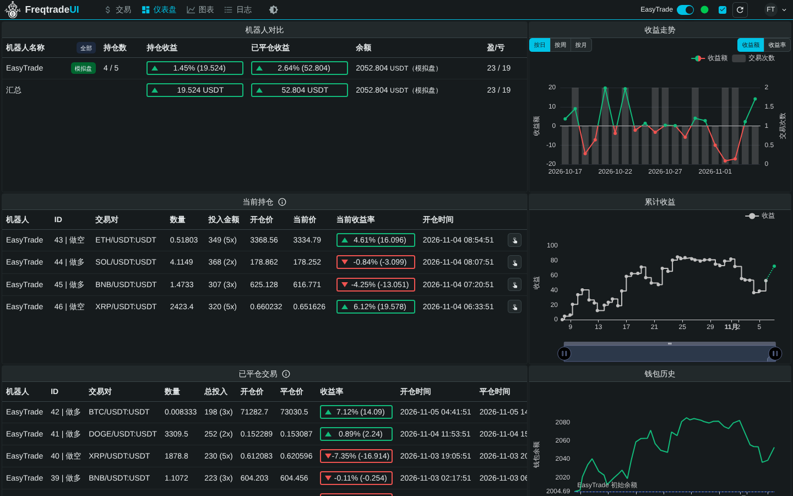

# FreqUI 中文版（汉化补丁）

freqtrade 自带的网页界面 FreqUI 官方只有英文（官方的多语言 PR #2841 没有被合并）。
本目录用一个**补丁**把 FreqUI 汉化：补丁打在官方固定版本 **FreqUI 3.2.1** 上（freqtrade 2026.10 官方镜像里装的也是 3.2.1），
升级时把补丁重新打到新版本上即可。



更多截图（1440×900，模拟数据）：[登录](screenshots/login.png) · [交易 / 当前持仓](screenshots/trade.png) ·
[回测结果](screenshots/backtest.png)（[整页](screenshots/backtest-full.png)） · [图表](screenshots/chart.png) ·
[设置](screenshots/settings.png)（[整页](screenshots/settings-full.png)）

## 目录内容

| 文件 | 作用 |
|---|---|
| `patches/frequi-3.2.1-zh-CN.patch` | 汉化补丁（`git diff 3.2.1..zh-cn`，含 vue-i18n 依赖和锁文件变更） |
| `build.sh` | 克隆官方 FreqUI 3.2.1（核对上游提交号）→ 打补丁 → `pnpm install --frozen-lockfile` → `pnpm build` → 输出到 `dist/` |
| `install-into-venv.sh` | 把 `dist/` 装进 venv 里的 freqtrade，效果和 `freqtrade install-ui` 相同 |
| `screenshots/` | 中文界面截图 |
| `dist/`、`.build/` | 构建产物和临时克隆目录（已在 `.gitignore`；`.build/` 构建完自动删除，随时可以重新生成） |

Docker 方式用的是 `docker/Dockerfile.freqtrade-zh`（多阶段构建：node:22 里执行 `build.sh`，
再把结果装进 `freqtradeorg/freqtrade:2026.10`）。

## 原理

- 补丁给 FreqUI 加上 [vue-i18n](https://vue-i18n.intlify.dev/)（v11），把所有界面文字换成翻译 key。
  翻译文件按模块分开：`src/locales/en/*.json` 和 `src/locales/zh-CN/*.json`（两边 key 完全相同，约 1000 条）。
- **默认中文**，可以在设置页切换成英文；找不到中文的 key 时自动显示英文。
- 一起本地化的还有：Nuxt UI 组件自带的文字（下拉框、分页等）、持仓时长（`2天 5小时 36分钟`）、
  ECharts 图表的图例 / 坐标轴 / 提示框 / 工具栏、时间轴上的月份（`11月`）。
- 术语统一按 `I18N_GLOSSARY.md`（在补丁里，FreqUI 仓库根目录）：交易对、当前持仓、已平仓交易、投入金额、模拟盘 / 实盘、
  手动开仓、强制平仓、做多 / 做空、资金费、最大回撤、盈亏比、周期、K线……
- **不翻译**：交易对名称、策略名、指标名、交易所名、周期（`5m`）、币种、数字，
  以及机器人发来的内容——日志、平仓原因（`roi`、`stop_loss`、`exit_signal`…）、开仓标签、错误信息原文。
  发给 API 的值也完全不变，所以中文界面和英文界面对机器人来说没有任何区别。
- 只有很简单、固定的取值做了显示映射：交易模式（现货 / 杠杆 / 合约）、保证金模式（逐仓 / 全仓）、
  订单类型（限价 / 市价）、方向（做多 / 做空）。

## 构建

需要：git、Node.js ≥ 22、pnpm（没装的话脚本自动用 Node 自带的 corepack）、能访问 github.com 和 npm 源。

```bash
make zh-build                    # 等价于：bash frequi-zh/build.sh
```

约 1 分钟（首次下载依赖会久一些）。结果在 `frequi-zh/dist/`，里面的 `.uiversion` 是 `3.2.1-zh-CN`，
FreqUI 设置页显示的「界面版本」就是它（后面跟着 FreqUI 源码的提交号）。
构建时会自动检查翻译文件（中英文 key 是否一致、有没有缺的或多余的 key），有问题会直接失败。

构建结果可复现：
- 克隆后核对上游提交号（3.2.1 = `4e1717ad1eaaf98447ebe2bdf4c00c8d755d2191`，写在 `build.sh` 里）。tag 被改动过，
  或者 `FREQUI_REPO` 指向的镜像内容和官方不同，构建直接失败，不会悄悄用别的代码构建。
- 依赖严格按锁文件安装（`pnpm install --frozen-lockfile`）。失败（网络问题、锁文件不匹配）就停止，不会自动换成别的依赖版本；
  只有升级调试时才用 `ALLOW_LOCKFILE_UPDATE=1` 放开。

可选环境变量：`FREQUI_TAG`（默认 `3.2.1`）、`FREQUI_COMMIT`（期望的上游提交号，默认按 `FREQUI_TAG` 取 `build.sh` 里记录的值）、
`PATCH`（补丁路径）、`OUT_DIR`（输出目录）、`FREQUI_REPO`（克隆地址，网络不好时可以换镜像，提交号核对照样生效）、
`ALLOW_LOCKFILE_UPDATE=1`（锁文件不匹配时允许普通 install，仅升级调试用）、
`KEEP_BUILD=1`（保留 `frequi-zh/.build/` 里打好补丁的源码，默认构建完就删掉，约 500 MB）。

## 安装

### venv 方式

```bash
make zh-build                    # 先构建
make zh-install                  # 装进本项目的 .venv（等价于 bash frequi-zh/install-into-venv.sh .venv）
bash frequi-zh/install-into-venv.sh /其他/venv/目录     # 装进别的 venv
bash frequi-zh/install-into-venv.sh --dry-run          # 只显示会装到哪里，不改文件
```

脚本用 freqtrade 自己的代码算出界面目录 `<site-packages>/freqtrade/rpc/api_server/ui/installed/`，
用 freqtrade 自己的 `clean_ui_subdir` 清空旧文件，复制新文件，再写入 `.uiversion`——和 `freqtrade install-ui` 一模一样，
只是文件来自本地构建，而不是从 GitHub 下载英文版。freqtrade 每次请求都直接读这个目录，**不需要重启**，浏览器强制刷新（Ctrl+Shift+R）即可。

注意：以后再执行 `freqtrade install-ui`（或 `make venv`）会换回英文版。`make venv` 已经改成：如果 `frequi-zh/dist` 存在，就自动装中文版。

### Docker 方式

`docker/docker-compose.yml` 里的 `ui` 和 `freqtrade` 服务已经改成本地构建的镜像
`easytrade/freqtrade-zh:2026.10-frequi-3.2.1`（`cli` 服务不需要网页，继续用官方镜像）。

```bash
make docker-build                # 构建镜像（本地没有时，第一次 make ui / make up 也会自动构建）
make ui                          # 看回测结果 → http://127.0.0.1:8080（端口仍然只绑定 127.0.0.1）
make up                          # 交易机器人
```

这个镜像只在本地构建，永远不会从 Docker Hub 拉取（`docker/docker-compose.yml` 里设置了 `pull_policy: never`，
`docker compose pull` 也会跳过它），所以不会误用别人发布的同名镜像。

改了补丁、换了版本之后，要重新 `make docker-build`，再 `make down && make ui`（或 `make up`）。
构建只把 `frequi-zh/build.sh`、`install-into-venv.sh` 和 `patches/` 送进 Docker（见 `docker/Dockerfile.freqtrade-zh.dockerignore`），
`.env`、`user_data/` 不会进入镜像。

## 切换语言

FreqUI 右上角头像（`FT`）菜单 → **设置**（或直接打开 <http://127.0.0.1:8080/settings>）→「界面设置」第一项
**语言 / Language** → 选 **中文** 或 **English**，立即生效。

- 选择保存在当前浏览器里（和其他 FreqUI 设置一起存在 localStorage 的 `ftUISettings`），换浏览器或清除网站数据后会回到默认的中文。
- 两种语言用的是同一套代码，切换不会影响机器人。

## 升级 FreqUI（把补丁打到新版本上）

FreqUI 出新版本（例如 3.3.0）时：

```bash
# 1. 克隆官方仓库（需要完整历史，补丁里带了完整的文件哈希，可以三方合并）
git clone https://github.com/freqtrade/frequi.git frequi-zh-work
cd frequi-zh-work
git checkout -b zh-cn 3.3.0

# 2. 三方合并方式打补丁：能自动合并的自动合并，合并不了的在文件里标出冲突
git apply --3way ../easytrade/frequi-zh/patches/frequi-3.2.1-zh-CN.patch
git status                       # "both modified" 的文件就是冲突
```

3. **解决冲突**（文件里 `<<<<<<<` 到 `>>>>>>>` 之间）：
   - **组件代码冲突**：上游改了代码、我们把英文换成了 `t('...')`。保留上游的新代码，再把里面的英文文字换成 `t('key')`。
     上游新增的文字要在 `src/locales/en/<模块>.json` 和 `src/locales/zh-CN/<模块>.json` **两个文件**里各加同一个 key。
   - **`pnpm-lock.yaml` 冲突**：不要手改。用上游的锁文件，再让 pnpm 把 vue-i18n 加回去：
     `git checkout 3.3.0 -- pnpm-lock.yaml && pnpm install`（`package.json` 里要保留 `"vue-i18n"` 这一行）。
   - **`package.json` 冲突**：保留上游的版本号，同时保留 `"vue-i18n"` 依赖和 `"check-i18n"` 脚本。
   - 解决完：`git add -A && git commit -m "i18n: zh-CN for FreqUI 3.3.0"`。

4. **检查**（任何一步失败都先修好）：

```bash
pnpm install
pnpm build && pnpm typecheck && pnpm lint-ci && pnpm test:unit --run
pnpm check-i18n                  # 缺 key / 多余 key / 中英文不一致 → 错误；新出现的英文文字 → 警告
pnpm test:e2e-chromium           # 官方 e2e 测试（自动切成英文跑）
node scripts/zh-screenshots.mjs --out ../easytrade/frequi-zh/screenshots   # 截图，逐张看有没有英文、错位
```

   `check-i18n` 的警告会列出上游新加、还没翻译的英文；上游删掉的组件会让对应 key 变成「未使用」错误，从两个 json 里删掉即可。
   翻译规范和术语见仓库根目录的 `I18N_GUIDE.md`、`I18N_GLOSSARY.md`。

5. **生成新补丁、更新版本号**：

```bash
git diff --full-index 3.3.0..zh-cn > ../easytrade/frequi-zh/patches/frequi-3.3.0-zh-CN.patch
```

   然后在 easytrade 里把 `3.2.1` 改成 `3.3.0`：`frequi-zh/build.sh`（`FREQUI_TAG` 默认值，并在 `case` 里加一行
   `3.3.0) DEFAULT_FREQUI_COMMIT=<git rev-parse 3.3.0^{commit} 的结果> ;;`）、
   `docker/Dockerfile.freqtrade-zh` 和 `docker/docker-compose.yml`（`FREQUI_TAG`、镜像名），旧补丁可以删掉。
   最后 `make zh-build && make zh-install` 或 `make docker-build` 验证。

只升级 freqtrade、不升级 FreqUI 时不用动补丁：改 `requirements.txt`、`docker/docker-compose.yml`（两处镜像版本 / `FREQTRADE_IMAGE`）后重新构建即可。

## 常见问题

- **按钮图标是空白小方块**：FreqUI 的部分图标是浏览器打开页面时从 `api.iconify.design` 加载的（官方英文版也一样）。
  访问不到这个网站时只是图标不显示，功能不受影响。
- **打开还是英文**：① 设置页看看语言是不是选了 English；② 浏览器强制刷新（Ctrl+Shift+R）清缓存；
  ③ 设置页顶部「界面版本」应该以 `3.2.1-zh-CN` 开头，不是的话说明装的还是官方版（`freqtrade install-ui` 会换回英文版），重新 `make zh-install` 或 `make docker-build`。
- **`build.sh` 提示补丁无法应用**：`FREQUI_TAG` 和补丁版本不匹配。换 FreqUI 版本要先按上面的「升级 FreqUI」生成新补丁。
- **`pnpm install` 很慢或失败**：检查能否访问 npm 源；国内网络可以先
  `export npm_config_registry=https://registry.npmmirror.com COREPACK_NPM_REGISTRY=https://registry.npmmirror.com` 再构建。
- **翻译不合适**：改 `src/locales/zh-CN/*.json`（在上面的 `frequi-zh-work` 克隆里），按第 4、5 步检查并重新生成补丁。
